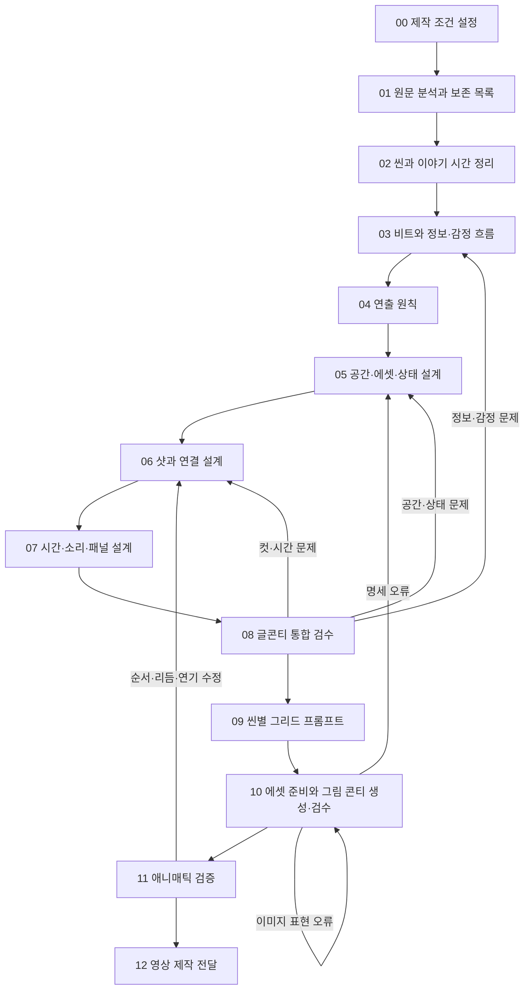

# 10분 내외 단편·애니메이션: 시나리오 → 글콘티 → 씬별 그림 콘티 워크플로우

버전: 1.1 · 단편 3편의 글콘티 시험·자기검토 반영 · 수정일: 2026-09-22

이 문서는 앞선 리서치를 실제 작업 순서와 프로그램 처리 규칙으로 옮긴 것이다. 이미 작성한 시나리오를 입력받는 것을 출발점으로 한다. v1.1에는 직접 창작한 단편 3편의 시나리오·글콘티·그리드 프롬프트 작성, 자기검토, 수정과 데이터 검사 결과를 반영했다. 실제 이미지·애니매틱은 아직 생성하지 않았다.

시험 결과와 최종 산출물: [3회 테스트 종합 보고서](</Users/abendmusik/Library/Mobile Documents/com~apple~CloudDocs/RAPA 미디어아카데미/00 NS-Plating/research/workflow-tests/README.md>).

**중심 산출물은 원문과 연결되는 글콘티, 연속성 기록, 그림 콘티 생성 프롬프트다.** 이미지 생성과 애니매틱은 글콘티를 검증하는 후속 단계까지 설계한다.

## 1. 사용자 제작 순서와 대응

| 사용자의 제작 단계 | 이 문서에서 처리하는 구간 | 완료 결과 |
|---|---|---|
| 1. 시나리오 작성 | 입력으로 받음 | 원문 버전 확정 |
| 2. AI로 글콘티 제작 | STEP 00~08 | 검수한 글콘티와 시간·연속성 기록 |
| 3. 그림 콘티 프롬프트 자동 출력 | STEP 09 | 씬별 그리드 생성 명세·프롬프트 |
| 4~5. 이미지 모델로 씬별 그리드 생성 | STEP 10 | 검수한 그림 콘티 시트와 개별 패널 |
| 영상화 전 확인 | STEP 11~12 | 애니매틱 검증 및 영상 제작 전달 패키지 |

주된 설계 범위는 STEP 00~09다. STEP 10~12는 이후 프로그램이 연결해야 하는 작업과 수정 경로를 명확히 하기 위해 포함한다.

공유한 장편 워크플로우에서 단계별 산출물·비평·변경 이력의 원칙을 참고한다. 단편에서는 15비트, 막별 글자 수, 장편 씬 수를 강제하지 않는다. 이미 있는 시나리오의 인물과 사건을 다시 개발하는 과정도 자동으로 추가하지 않는다.

## 2. 전체 흐름



단계별 확인은 작업 품질을 위한 검사다. 모든 단계에서 사용자에게 승인창을 띄우는 방식은 기본값으로 두지 않는다. 이미 합의한 범위의 위치·구도·번호 정리와 오류 수정은 계속 진행한다. 원문의 사건·결말·대사를 바꾸는 중요한 선택은 변경 제안으로 분리해 감독이 판단할 수 있게 한다.

## 3. 실행 전 기본 규칙

1. 시나리오 원문을 덮어쓰지 않는다. 콘티에서 추가한 행동·미술·촬영 선택은 연출 제안으로 추적한다.
2. 장소, 씬, 비트, 샷, 패널, 생성 시트의 ID를 구분한다.
3. ID는 식별자이고 편집 순서는 별도 값이다. 순서를 바꿔도 기존 ID를 무조건 다시 매기지 않는다.
4. 이야기 속 시간 순서와 관객이 보는 편집 순서를 구분한다. 회상·교차 편집에 필요하다.
5. 모든 샷에는 전달 기능과 시작·종료 상태를 기록한다.
6. 상태를 ‘보임/가려짐/화면 밖’과 ‘존재/부재’로 나눠 기록한다.
7. 수치·참조·시간 합계는 코드로, 의미·연기·실제 이미지 일치는 별도 검수로 확인한다.
8. 먼저 전체 작품을 설계하고, 생성은 짧은 대표 구간으로 시험한 뒤 확장한다.

다음 기본값은 프로그램 설계 예시다. 사용자가 정한 값이 있으면 그것을 우선한다.

| 항목 | 초기값/처리 |
|---|---|
| 목표 총시간 | 600초 |
| ‘내외’의 임시 허용 범위 | ±60초; 납품 규격이 있으면 그 값으로 교체 |
| 타이틀·크레딧 | 포함 여부와 시간을 별도 기록; 미정이면 본편/전체 시간을 함께 표시 |
| 시각 형식 | 미정 상태를 허용; 2D/3D/실사풍을 입력받음 |
| 화면비 | 별도 요구가 없을 때 16:9를 가정 목록에 기록 |
| 편집 프레임률 | 미정이면 초 단위로 설계; 애니매틱 전에 지정 |
| 비트·씬·샷 수 | 고정하지 않음 |
| 그리드 | 2열×2행으로 시험; 패널 수·출력 해상도에 따라 변경 |
| 자동 수정 반복 | 같은 오류에 최대 2회 수정 후 원인·대안 정리; 오류를 통과 처리하지 않음 |
| 이미지 재생성 예산 | 별도 설정; 텍스트 수정 횟수와 분리 |

## STEP 00. 제작 조건과 변경 범위 설정

**목적:** 무엇을 완성해야 하는지와 AI가 어디까지 결정할 수 있는지를 정한다.

**입력:** 시나리오, 목표 시간, 기존 캐릭터·배경 자료, 사용자의 연출 의도.

**작업**

1. 형식, 장르, 관객, 화면비, 목표 시간과 크레딧 포함 여부를 정리한다.
2. 전달할 감정 변화를 한 문장으로 적는다. 예: ‘호기심으로 따라가다가 마지막에 상실감을 느낀다.’
3. 사건·결말·대사 중 유지할 항목과 수정 가능한 항목을 구분한다.
4. 기존 에셋, 미정 사항, 제작상의 제한을 기록한다.
5. 실제 시나리오의 버전과 입력 파일을 고정한다.

**산출물:** 제작 브리프, 프로젝트 설정, 가정·미정 사항 목록.

**통과 기준:** 목표 결과와 원문 버전이 명확하다. 미정 사항이 어떤 후속 단계에 영향을 주는지 식별된다.

**미정일 때:** 화풍이 미정이어도 사건 분석은 진행한다. 결말의 의미가 충돌하면 해당 해석을 확정하지 않고 대안을 나란히 기록한다.

**AI 호출 요지:** “새로운 이야기를 쓰지 말고 제작 조건과 변경 범위를 정리하라.”

## STEP 01. 원문을 분석하고 보존 목록 만들기

**목적:** 콘티가 진행되는 동안 빠뜨리면 안 되는 사건·대사·정보를 식별한다.

**입력:** 원문과 제작 브리프.

**작업**

1. 씬 헤딩, 지문, 대사, 소리, 화면 글자를 분류한다.
2. 원문 문단·대사에 추적용 ID를 붙인다.
3. 인물, 장소, 소품의 이름을 정리한다. 별칭은 같은 항목에 연결한다.
4. 사건의 원인과 결과, 중요한 정보 공개, 복선과 회수를 추출한다.
5. 각 추출값을 `원문 명시 / 해석 / 연출 제안 / 미정`으로 구분한다.
6. 모순·공백은 문제 목록에 남긴다. AI가 조용히 내용을 보충하지 않게 한다.

**보존 목록 예시**

| 원문 ID | 반드시 보존할 내용 | 전달 수단 | 변경 상태 |
|---|---|---|---|
| ACT_01 | 봉투를 연 뒤 열쇠를 발견 | 행동·이미지 | 유지 |
| SND_01 | 발견 이후 노크 세 번 | 소리 | 유지 |
| ACT_02 | 열쇠를 숨기고 문을 봄 | 행동 | 유지 |

**산출물:** 구조화한 원문, 보존 목록, 명칭 목록, 원문 문제 목록.

**통과 기준:** 모든 원문 구간이 분류되며, 사건과 필수 대사를 추적할 수 있다. 설명적 지문도 삭제하지 않고 시각화 검토 대상으로 남긴다.

**실패 시:** 해당 원문 구간을 다시 분석한다. 원문 자체의 충돌은 시나리오 수정 후보로 분리한다.

## STEP 02. 씬·장소·시간·전체 분량 정리

**목적:** 장소 재사용과 이야기의 진행 단위를 분리한다.

**입력:** 구조화 원문과 보존 목록.

**작업**

1. 원본 씬 번호를 보존하고 내부 씬 ID를 붙인다.
2. 같은 공간은 동일한 `location_id`로 묶는다. 같은 장소라도 다른 날·회상·다른 상태는 구분한다.
3. 씬별 시작 상태, 목표, 방해, 전환점, 종료 상태를 적는다.
4. 시나리오의 서술 순서와 이야기의 날짜·시간 관계를 따로 기록한다.
5. 대사 리딩과 행동량을 근거로 초기 시간을 추정한다. 추정 범위와 대표값을 함께 남길 수 있다.
6. 본편·타이틀·크레딧 시간을 분리해 전체 분량을 확인한다.

| 씬 카드 필드 | 내용 |
|---|---|
| scene_id / 원문 씬 번호 | 장면 식별 |
| location_id / 실내·실외 | 공간 에셋과 연결 |
| 이야기 시간·편집 순서 | 시간 관계와 관객에게 보이는 순서 |
| 등장인물·의상 버전 | 해당 장면의 인물 상태 |
| 시작 → 전환 → 종료 | 씬에서 달라지는 것 |
| 필수 정보 | 이 씬을 통해 알아야 할 것 |
| 임시 시간 / 추정 근거 | 리딩 전 추정인지 실제 녹음 기준인지 |

**시험 반영:** 원문 씬 ID와 실제 샷의 장소 ID를 따로 둔다. 한 원문 묶음에서 실내→실외로 이동하면 장소별 제작 세그먼트를 나눈다. 원문 ID를 유지하는 것은 해당 묶음을 하나의 촬영 장소로 취급한다는 뜻이 아니다.

**산출물:** 씬 목록, 장소 목록, 이야기 시간표, 전체 분량표.

**통과 기준:** 장소·시간 변화가 추적되고 씬마다 존재 이유가 있다. 목표 시간을 벗어나면 차이를 숨기지 않고 원인을 표시한다.

**주의:** 새 인물이 들어왔다고 반드시 새 씬을 만들지 않는다. 단일 공간 단편도 허용한다. 교차 편집은 같은 씬을 여러 번 참조할 수 있으므로 `편집 순서`와 `씬 고유 ID`를 혼동하지 않는다.

## STEP 03. 비트와 관객의 정보·감정 흐름 설계

**목적:** 카메라를 선택하기 전에 무엇을 언제 전달해야 하는지 정한다.

**입력:** 씬 카드, 원문, 제작 의도.

**작업**

1. 정보·목표·행동·감정·관계의 의미 있는 변화를 비트로 나눈다.
2. 각 비트의 시점 인물을 정한다. 객관적으로 보여주는 구간도 명시한다.
3. 관객과 등장인물 각각이 무엇을 알고 모르는지 적는다.
4. 공개할 정보와 계속 숨길 정보를 구분한다.
5. 추상적인 감정을 관찰 가능한 행동·표정·소리로 번역한다.
6. 이야기 전체의 연결을 읽어 불필요한 반복과 설명 부족을 찾는다.

**비트 카드 예시**

| 항목 | 예 |
|---|---|
| 비트 | B03: 발견 |
| 원문 근거 | ACT_01 |
| 관객의 이전 정보 | 봉투가 있다. 내용물은 모른다. |
| 관객의 이후 정보 | 안에 놋쇠 열쇠가 있다. |
| 인물의 목표 | 내용물을 확인한다. |
| 의도한 감정 | 궁금증 → 발견 |
| 화면·소리의 증거 | 오른손 위 열쇠가 읽히는 화면 |
| 유지할 비공개 정보 | 열쇠가 여는 대상 |

**산출물:** 비트 목록, 정보 공개표, 감정 변화표, 중요 단서의 선행·후행 관계.

**통과 기준:** 원문의 필수 사건과 정보가 비트에 연결된다. 아직 알지 못하는 사실 때문에 행동하는 모순이 없다. 숨겨야 하는 정보가 앞에서 공개되지 않는다.

**실패 시:** 비트 순서나 전달 수단을 조정한다. 원문의 사건 순서나 의미가 달라지는 수정은 별도 제안으로 남긴다.

**감독이 볼 질문:** “관객이 이 구간에서 무엇을 느끼기를 바라며, 무엇을 보고 들어서 그렇게 느끼는가?”

## STEP 04. 작품에 맞는 연출 원칙 정하기

**목적:** 씬마다 서로 다른 취향의 카메라·리듬이 섞이지 않게 기준을 둔다.

**입력:** 제작 브리프와 비트·감정 변화표.

**작업**

1. 시점의 거리감을 정한다. 인물과 함께 발견할지, 관객에게 먼저 알려줄지 결정한다.
2. 샷 크기의 변화 기준을 정한다. 예: 공간 이해는 넓게, 결정의 순간은 가까이.
3. 카메라 이동을 사용할 이유를 정한다. 추적, 공개, 관계 변화 등으로 설명한다.
4. 편집 리듬을 정한다. 고정된 초 단위 공식 대신 빨라지거나 머무를 구간과 이유를 적는다.
5. 색·광원·소리·반복 이미지의 원칙을 정한다. 원문에 없는 모티프는 선택적인 제안으로 둔다.
6. 애니메이션은 형태·물성·과장의 허용 범위를 정한다.

**산출물:** 1~2페이지 정도의 연출 기준서. 길이는 목표치일 뿐 필수 분량이 아니다.

**통과 기준:** 원칙이 구체적인 선택을 돕는다. ‘시네마틱하고 감성적으로’ 같은 말만 남아 있지 않는다.

**예시:** “열쇠를 발견하기 전에는 내용물을 알아볼 수 있는 인서트를 쓰지 않는다. 노크는 문을 보여주기 전에 들린다. 손을 숨기는 행동은 몸과 손이 함께 보이는 구도로 전달한다.”

## STEP 05. 공간·에셋·동선·상태 설계

**목적:** 모든 샷이 공유할 물리적 세계를 만든다.

**입력:** 씬 카드, 비트, 연출 기준, 기존 에셋.

**작업**

1. 인물·장소·의상·중요 소품을 에셋 목록으로 만든다.
2. 장소마다 문·창문·가구·인물·주요 소품의 배치를 평면도 또는 좌표로 정한다.
3. 인물의 동선을 행동 구간별로 표시한다. 이동을 영상에서 보여줄지 생략할지도 적는다.
4. 주요 행동 축과 카메라 후보 영역을 표시한다. 축이 바뀌면 적용 구간을 기록한다.
5. 불변 조건과 사건에 따라 바뀌는 상태를 분리한다.
6. 필요한 이미지 참조 목록을 만든다. 아직 이미지가 없으면 에셋 명세로 진행하되 준비 여부를 따로 표시한다.

| 에셋 | 최소 명세 | 필요한 참조의 예 |
|---|---|---|
| 인물 | 얼굴·체형·헤어·의상·특징 | 실제 샷에 필요한 정면·사선·옆모습·전신 |
| 장소 | 구조·출입구·창문·가구·광원 | 공간 기준 이미지, 필요한 역방향 이미지, 평면도 |
| 소품 | 형태·크기·색·수량·중요 특징 | 손에 잡힌 크기, 닫힘/열림 등의 상태 |
| 애니메이션 캐릭터 | 비율·귀/꼬리/장식·관절·물성 | 핵심 포즈, 표정, 실루엣 |

여러 각도의 참조는 필요한 시점을 충족하는 범위로 준비한다. 모든 캐릭터에 불필요한 대형 시트를 일괄 제작하지 않는다.

**상태 기록 예시**

| 시점 | 봉투 | 열쇠 | 지윤의 지식 | 관객의 지식 |
|---|---|---|---|---|
| 씬 시작 | 봉인, 책상 위 | 봉투 안, 보이지 않음 | 내용물 모름 | 내용물 모름 |
| 개봉 직후 | 열림, 책상 위 | 오른손, 손에 가려짐 | 확인 중 | 아직 식별 불가 |
| 공개 후 | 열림, 책상 위 | 오른손 손바닥, 보임 | 열쇠임을 앎 | 열쇠임을 앎 |
| 은폐 후 | 열림, 책상 위 | 오른손, 등 뒤 | 알고 숨김 | 숨겼음을 앎 |

**시험 반영:** 물성에는 행동의 전제 조건도 포함한다. 예: 전원이 끊긴 뒤의 로봇 동작은 중력·스프링 등 수동 원인으로 설명되어야 한다. 도크 정렬처럼 특정 구간에만 성립하는 위치를 전역 불변 조건으로 올리지 않는다. 과거/현재의 외형과 흠집의 생성 시점을 별도로 관리한다.

**산출물:** 에셋 목록, 씬별 공간 배치, 동선·카메라 후보, 연속성 조건과 상태 기록.

**통과 기준:** 화면상의 좌우와 공간상의 위치를 구분한다. 손·물체의 소유와 상태가 행동으로 설명된다. 실재 이미지 참조와 아직 작성만 된 명세를 혼동하지 않는다.

**실패 시:** 공간·동선을 먼저 조정하고 영향을 받는 샷을 다시 설계한다. 잘못 생성된 배경을 기준으로 원문 사건을 바꾸지 않는다.

## STEP 06. 비트를 샷과 연결로 변환

**목적:** 읽을 수 있는 이야기를 편집 가능한 영상으로 번역한다.

**입력:** 원문, 비트, 연출 기준, 공간·상태 기록.

**샷 선택 순서**

1. 이 비트에서 관객이 반드시 볼/들을 것을 한 문장으로 정한다.
2. 같은 샷을 유지하면서 전달할 수 있는지 먼저 검토한다.
3. 새 화면이 필요하면 샷 크기, 시점, 각도, 카메라 위치를 정한다.
4. 인물·소품의 화면 위치와 시선·동작을 명시한다.
5. 카메라 이동이 필요하면 시작 구도, 이동 경로, 끝 구도와 이유를 적는다.
6. 어디서 자를지 정한다. 동작 중간, 발견 직후, 반응을 읽은 뒤 등 정확한 계기를 적는다.
7. 다음 샷이 이어받을 정보·동작·상태를 연결 기록에 남긴다.

**글콘티 표 기본 형식**

| 샷 ID | 길이 | 화면·행동 | 카메라·구도 | 대사·음향 | 정보·감정 | 연결·연속성 |
|---|---:|---|---|---|---|---|
| SC01_SH05 | 임시 10초 | 손바닥 위 열쇠를 공개. 끝부분 노크에 손이 움찔 | CU, 고정, 오른손과 열쇠가 읽힘 | 마지막 2초 노크 세 번 | 내용물 공개 → 경계 | 다음 MS에서 같은 오른손으로 열쇠를 숨김 |

표 뒤의 데이터에는 원문 참조, 비트 ID, 에셋 버전, 시작·종료 상태, 패널 정보를 더 상세히 보존한다.

**컷 연결 기록**

| 필드 | 예 |
|---|---|
| 출발 → 도착 샷 | SH05 → SH06 |
| 연결 원리 | 외부 소리에 대한 반응 |
| 전환 방식 | 하드컷, 노크 잔향은 이어짐 |
| 잘리는 순간 | 열쇠를 쥐기 시작하는 순간 |
| 이어받을 동작 | 같은 오른손이 닫히며 등 뒤로 이동 |
| 유지 조건 | 열쇠 하나, 오른손, 열린 봉투, 닫힌 문 |
| 새 정보 | 인물이 내용물을 숨기려 한다 |

**산출물:** 글콘티 초안, 샷별 상세 데이터, 컷 연결 목록.

**통과 기준:** 샷마다 존재 이유가 있고 필수 비트를 덮는다. 시간 순서가 연속인 샷의 동작과 상태가 연결된다. 대사를 말할 때마다 자동으로 컷이 바뀌지 않는다.

**생성 난이도 대안:** 복잡한 손 조작은 더 단순한 구도, 행동의 일부 생략, 대상과 반응의 분리 등을 검토한다. 대안을 적용할 때도 원인·결과와 공개 시점은 유지한다.

## STEP 07. 시간·음향·패널·애니메이션 연기 설계

**목적:** 샷 목록을 실제 길이를 가진 영상 설계로 만든다.

**입력:** 글콘티 초안, 원문 대사, 임시 녹음 또는 리딩, 상태 기록.

**작업**

1. 대사를 실제로 읽거나 임시 녹음해 기준 시간을 얻는다. 불가능하면 추정 상태로 표시한다.
2. 동작과 대사가 동시에 진행되는 구간, 반응을 기다리는 구간, 침묵을 구분한다.
3. 효과음·환경음·음악의 시작과 종료를 화면과 별도 시간축에 놓는다.
4. 각 샷의 편집 길이를 정하고 전체 길이를 다시 계산한다.
5. 한 장으로 이해되는 샷은 대표 패널, 포즈·카메라가 크게 바뀌는 샷은 여러 패널을 배정한다.
6. 패널별로 정확히 어느 순간을 그릴지, 무엇이 보여야 하는지 기록한다.
7. 애니메이션은 준비 동작, 핵심 포즈, 접촉, 정지, 후속 동작과 허용 변형을 추가한다.

**시간 저장 규칙**

- 초 단위의 임시 설계는 애니매틱 프레임률을 정한 뒤 정수 프레임으로 변환한다.
- 편집 구간은 시작 포함·끝 제외로 통일한다. 예: 24fps에서 7초는 `[0, 168)`이다.
- 패널의 순간은 해당 샷 안에 있어야 한다. 대표 패널의 시점과 애니매틱에서 그 그림을 유지할 시간은 별도다.
- 같은 샷 안의 패널 표시 구간은 샷의 시간을 나눠 쓴다. 각 패널에 샷 전체 길이를 반복 부여하지 않는다.
- 패널 교체는 포즈의 진행을 표현할 수 있다. 실제 컷 경계는 `shot_id`가 바뀌는 지점 등 별도 편집 정보로 표시한다.
- 대사가 다음 샷까지 이어지면 하나의 오디오 이벤트를 여러 화면 구간에 연결한다. 대사 자체를 복제하지 않는다.

**전체 시간 계산**

기본 하드컷에서는 샷 길이를 합산한다. 화면이 겹치는 전환은 타임라인의 중복 구간을 제외하고 계산한다. J/L컷의 오디오 중첩은 영상 길이에 다시 더하지 않는다. 타이틀·크레딧은 독립된 영상 구간으로 합산한다. 생성 클립의 여유분은 본편 시간에 포함하지 않는다.

**시험 반영:** 각 패널에 샷 내부 시점과 그 순간의 상태를 기록한다. 패널이 샷 중간의 행동을 보여주면 샷 시작·종료 상태를 기계적으로 복사하지 않는다. 점멸·타격·발사처럼 횟수가 중요한 사건은 event_id, 발생 번호, 시점, 지속 시간을 타임라인에서 추적한다. 송신자와 수신자를 교차 편집해도 같은 사건을 실수로 두 번 재생하지 않는다.

**산출물:** 샷별 시간표, 오디오 큐 목록, 패널 명세, 애니메이션 연기 노트.

**통과 기준:** 본편과 전체 시간이 구분된다. 모든 패널이 한 샷에 속하고 시간 범위를 벗어나지 않는다. 필요한 대사와 행동의 실행 가능성을 리딩 또는 추정 근거로 설명한다.

**초과 시 수정 순서:** 불필요한 반복 → 과도한 멈춤 → 중복 설명 → 샷 통합을 검토한다. 핵심 감정의 체류 시간을 일괄 배속하거나 모든 샷에서 같은 비율로 잘라내지 않는다. 사건·대사 변경이 필요하면 별도 수정안을 제시한다.

## STEP 08. 글콘티 통합 검수와 기준 버전 확정

**목적:** 이미지 생성 전에 텍스트·숫자·연결에서 잡을 수 있는 문제를 처리한다.

**입력:** 원문, 보존 목록, 씬·비트·샷·패널, 상태 기록, 시간·오디오 표.

검수는 다음 순서로 한다.

| 순서 | 검사 | 통과 기준 |
|---|---|---|
| 1 | 원문 대응 | 필수 사건·대사 누락 0건, 무단 변경 0건 |
| 2 | 이야기 이해 | 원인 없는 반응, 의도하지 않은 조기 공개를 해결 |
| 3 | 감정·리듬 | 의도와 실제 배열의 대응을 설명; 반복·설명 부족 검토 |
| 4 | 공간·상태 | 설명 없는 소품 이동·개폐·소유 변화 등 충돌 해결 |
| 5 | 시간 | 합계·프레임·음향 범위 정확, 목표 범위와 차이 명시 |
| 6 | 데이터 | ID 중복·없는 참조·필수값 누락 0건 |
| 7 | 제작 가능성 | 어려운 샷에 필요한 참조·대안 지정 |

**검수 결과 한 건의 형식**

```text
문제 ID: ISSUE_014
등급: error
대상: SC01_SH04 → SC01_SH05
근거: SH04에서는 오른손으로 꺼냈는데 SH05에는 왼손에 있다.
관객 영향: 물건과 행동의 연결이 끊긴다.
수정안: SH05를 오른손 기준으로 수정한다.
영향 범위: SH05 패널, 해당 그리드 프롬프트, SH05→SH06 연결
상태: open
```

**검사의 한계:** 코드가 `right_hand` 값을 확인했다고 실제 그림의 손이 맞는 것은 아니다. 감정 점수나 모델의 자기평가만으로 검증 완료 표시를 하지 않는다. 이미지가 필요한 확인은 `visual_review_required`로 남긴다.

**수정 원칙:** 문제가 생긴 원본 데이터에서 수정한 뒤 표·프롬프트를 다시 출력한다. 문서 표만 수정해 JSON과 서로 달라지게 만들지 않는다. 동일 문제에 반복 수정 한도를 넘기면 원인과 두세 개의 대안을 남기고, 독립적인 구간은 계속 진행한다.

**시험 반영:** 구조 검사가 통과한 뒤 생성 프롬프트를 그림 한 장의 지시로 다시 읽는다. 상태표에만 맞고 포즈·물성·공개 순서와 충돌하는 문장을 찾는다. 검수 코드에는 오류를 넣은 복사본으로 검출 시험을 실시하며, 인위적으로 넣은 오류와 실제 자기검토에서 찾은 문제를 합산하지 않는다.

**산출물:** 검수 결과, 수정 이력, 글콘티 기준 버전.

**텍스트 단계 완료:** `TEXT_VALIDATED`. 미해결 시각 검수와 에셋 준비 여부는 별도 상태로 남긴다. 이 시점이 사용자 요청 2번의 핵심 완료 지점이다.

## STEP 09. 씬별 그림 콘티 프롬프트 자동 작성

**목적:** 검수한 연출 데이터를 그림으로 옮길 수 있는 구체적인 생성 명세를 만든다.

**입력:** 글콘티 기준 버전, 패널 명세, 에셋 목록, 그리드 설정.

**작업**

1. 각 패널을 `원문 씬 → 실제 장소 → 시간 분기·의상 버전 → 편집 순서 → 샷 내 순간`에 따라 정리한다.
2. 그리드에 넣을 패널을 배정한다. 한 시트에는 하나의 씬·호환되는 에셋 상태만 넣는다.
3. 한 씬의 패널이 많으면 페이지를 늘린다. 칸 수에 맞춰 샷을 늘리거나 삭제하지 않는다.
4. 각 페이지에 호환되는 캐릭터·장소 기준을 전달하고, 소품·의상 상태는 패널별 순간에 맞춘다. 세계 상태표와 화면에 실제 보일 대상 목록을 구분한다.
5. 프로젝트 공통, 씬 공통, 패널별 가변, 그리드 배치를 조립한다.
6. 이미지 참조 ID를 실제 파일·업로드 참조와 대응시킨다. 아직 준비되지 않았다면 필요한 목록을 함께 출력한다.
7. 슬롯과 패널 ID를 연결한 표를 저장한다. 번호·대사·시간 표시는 이미지 바깥에 프로그램이 추가할 수 있게 한다.

**그리드 페이지 규칙**

| 규칙 | 처리 |
|---|---|
| 기본 배치 | 2열×2행, 왼쪽→오른쪽·위→아래 |
| 패널이 8개인 씬 | 4칸 페이지 두 장 |
| 패널이 7개인 씬 | 4칸 페이지 두 장, 마지막 한 칸은 빈칸 |
| 같은 샷에 두 패널 | 같은 shot_id에 서로 다른 panel_id |
| 페이지 경계 | 실제 영상의 컷으로 간주하지 않음 |
| 씬이 교차 편집됨 | 씬별 시트와 전체 편집 순서표를 별도로 유지 |
| 씬 중 의상·시간 상태가 크게 바뀜 | 원문 씬 ID를 보존하면서 별도 시트/세그먼트로 분리 |
| 페이지 수 | 각 호환 그룹마다 올림(패널 수 ÷ 페이지 칸 수)을 계산 |

각 패널이 16:9여도 시트 전체 비율은 행·열·여백에 따라 달라진다. 2×2와 3×3은 여백을 제외하면 16:9, 3열×2행은 8:3이다. 지원 출력 비율 안에서 패널의 유효 화면 영역과 여백을 설계한다.

**프롬프트 조립 형식**

```text
[목적]
하나의 씬을 검수하기 위한 그림 콘티 시트.

[그리드]
열/행, 각 패널의 화면비, 유효 패널 수, 읽기 순서, 빈 슬롯.

[공통 외형]
화풍, 캐릭터 정체성, 의상, 장소 구조, 주요 광원.
세계의 위치와 각 패널 화면의 좌우는 구분한다.

[첨부 참조]
이미지 A: 캐릭터 정체성.
이미지 B: 장소 구조.
이미지 C: 이번 페이지의 구도/배치.
실제 입력에 있는 참조만 기재한다.

[패널별 명세]
슬롯 번호, 샷 크기·카메라·구도, 관찰 가능한 한 순간,
인물의 포즈·시선, 중요한 물체와 상태, 보여주지 않을 정보.

[연속성]
유지할 조건과 패널 사이에서 의도적으로 달라지는 상태.

[표현 조건]
각 칸에는 명세의 한 순간만 표현.
그림 내부의 대사·번호·말풍선은 생략.
빈 칸을 새 장면으로 채우지 않음.
```

위 형식은 특정 제품의 API 문법이 아니다. 실제 모델이 요구하는 입력 형식으로 변환하는 부분은 별도로 둔다. “같은 인물”이라는 문구나 ID만 적었다고 시각적 참조가 전달된 것으로 처리하지 않는다.

**산출물:** 페이지별 프롬프트, 패널·슬롯 대응표, 참조 파일 목록, 필요한 에셋 생성 작업 목록.

**통과 기준:** 전체 패널이 누락·중복 없이 배정되고 모든 페이지에 필요한 공통 조건이 들어 있다. 새 연출이 이 단계에서 임의로 추가되지 않는다.

**두 가지 준비 상태:** 참조가 아직 없더라도 `PROMPT_COMPILED`는 가능하다. 실제 모델·참조·출력 규격까지 확인해야 `READY_FOR_IMAGE`가 된다. 이 구분으로 프롬프트 작성과 이미지 생성 준비를 혼동하지 않는다.

## STEP 10. 에셋 준비와 씬별 그리드 생성·검수

**목적:** 글콘티의 조건이 실제 그림에서도 구현되는지 확인한다. 이 단계는 후속 제작 설계이며 이번 문서 작성에서 실제 실행하지 않았다.

**입력:** 생성 준비 목록, 에셋 명세, 글콘티·패널 기준 버전, 페이지 프롬프트.

**작업 순서**

1. 사용할 모델의 실제 제품명, 참조 이미지 입력, 출력 비율·크기, 편집 지원을 확인한다.
2. 기존 에셋이 있으면 먼저 재사용한다. 부족한 인물·장소·소품 기준 이미지만 제작한다.
3. 기준 이미지를 명세와 대조한다. 장소의 역방향 이미지는 문·창문 구조가 같은지 함께 본다.
4. 확인한 에셋에 버전을 부여하고 페이지 프롬프트의 참조를 연결한다.
5. 대표 구간 30~60초 또는 필요한 소수 페이지를 먼저 생성해 일관성·판독성을 시험한다.
6. 통과한 설정으로 나머지 씬별 그리드를 생성한다.
7. 시트 전체, 각 패널, 앞뒤 페이지를 함께 검수한다.
8. 실제 칸 경계를 확인해 개별 패널을 추출하고 원래의 panel_id와 연결한다.

**검수 순서**

| 순서 | 확인할 것 | 예 |
|---|---|---|
| 1 | 페이지 구조 | 칸이 합쳐지거나 하나가 빠지지 않았는가 |
| 2 | 이야기 정보 | 열쇠가 지정한 패널 전에 보이지 않는가 |
| 3 | 행동·공간 | 같은 손, 같은 시선 대상, 같은 문 위치인가 |
| 4 | 정체성·상태 | 의상·얼굴·물건 수·개폐 상태가 맞는가 |
| 5 | 가독성 | 작은 패널에서도 핵심 표정·행동이 읽히는가 |
| 6 | 화풍·세부 품질 | 선·색·광원·불필요한 글자가 적절한가 |

**오류에 따른 대응**

- 명세가 맞고 그림만 틀림: 해당 패널/페이지를 수정하거나 재생성한다. 편집 지원 여부에 맞게 처리한다.
- 명세 자체가 모순: STEP 05~07의 원본 데이터를 수정하고 영향받는 프롬프트를 다시 조립한다.
- 여러 패널에서 얼굴·장소가 반복적으로 흔들림: 기준 에셋과 참조 전달을 재점검한다.
- 한 패널 수정으로 주변이 달라짐: 수정 요청한 영역만 보지 말고 반환된 시트 전체를 재검수한다.
- 이미지가 멋지지만 정보를 바꿈: 기존 콘티와의 차이를 변경 제안으로 기록한다. 자동으로 기준 상태를 바꾸지 않는다.

**산출물:** 검수한 시트, 개별 패널, 생성 설정·참조·버전 기록, 시각 검수 결과.

**통과 기준:** 필요한 모든 패널이 준비되고 주요 정보·행동·상태 오류가 해결된다. 추출한 패널의 해상도가 검수/후속 용도에 충분한지 확인한다.

**완료 상태:** `BOARD_VALIDATED`. 본편 영상 클립을 완성했다는 뜻은 아니다.

## STEP 11. 애니매틱으로 시간과 감정 검증

**목적:** 글과 정지 그림에서 좋아 보였던 콘티가 실제 재생 시간에서도 작동하는지 확인한다.

**입력:** 패널, 샷 시간표, 오디오 큐, 임시 대사·음향.

**작업**

1. 그리드 페이지 순서가 아니라 전체 편집 순서에 따라 패널을 타임라인에 배치한다.
2. 한 샷의 여러 패널에 해당 샷의 시간을 나눠 배정한다.
3. 대사·효과음·환경음을 넣고 그림과 소리가 만나는 시점을 맞춘다.
4. 이해를 돕는 최소한의 팬·확대·포즈 교체 등을 사용할 수 있다. 완성 애니메이션 제작은 별도다.
5. 먼저 작품 전체를 보고 이야기와 감정 흐름을 확인한다.
6. 문제가 있는 씬과 컷 연결만 다시 보며 시간을 조정한다.
7. 변경 내용을 시간표와 글콘티에 되돌려 기록한다.

**검토 질문**

- 시나리오를 읽지 않아도 누가 무엇을 원하고 왜 행동하는지 이해되는가?
- 중요한 정보가 읽히기 전에 지나가거나 너무 오래 머무르는가?
- 인물의 반응을 해석할 시간이 있는가?
- 개그·놀람·긴장에 필요한 기다림과 공개 시점이 맞는가?
- 소리가 들린 뒤 행동하는 순서와 감정의 원인이 맞는가?
- 등장인물의 이동과 소품의 변화를 따라갈 수 있는가?
- 전체 시간과 본편 시간이 설정 범위에 들어가는가?

음소거 검토는 시각적 설명 부족을 찾는 보조 수단이다. 소리 자체가 핵심 사건인 씬을 무조건 실패로 판정하지 않는다.

**수정 경로:** 길이·소리 시점만 바뀌면 STEP 07을 수정한다. 포즈·카메라·샷 순서가 바뀌면 STEP 06~09를 갱신하고 필요한 패널만 다시 만든다. 원문의 사건을 바꿔야 한다면 변경안을 원문과 대조한다.

**산출물:** 애니매틱, 갱신된 시간표, 확인된 수정 목록.

**통과 기준:** 필수 사건·정보가 전달되고 해결되지 않은 중대한 시간·연속성 문제가 없다. 사람의 검토가 아직 없으면 `ANIMATIC_READY_FOR_REVIEW`로, 검토가 완료되면 `ANIMATIC_VALIDATED`로 기록한다.

## STEP 12. 영상 제작 전달 패키지 고정

**목적:** 다음 제작자가 어떤 버전의 그림과 프롬프트로 무엇을 만들어야 하는지 알 수 있게 한다.

**작업**

1. 글콘티·패널·에셋·타임라인의 버전이 서로 맞는지 확인한다.
2. 각 샷에 시작/끝/대표 패널, 행동·카메라 설명, 편집 길이를 연결한다.
3. 음향은 별도 큐 목록으로 전달한다.
4. 생성 모델이 요구하는 클립 길이와 편집용 여유분은 후속 생성 계획에서 정한다.
5. 어려운 샷의 대안과 남은 확인 사항을 함께 전달한다.

**샷별 전달 항목:** 샷 ID, 에셋 버전, 패널 참조, 시작 상태, 동작·카메라, 종료 상태, 예정 편집 길이, 소리, 앞뒤 연결, 유지 조건, 허용 예외.

그리드 시트는 전체 연속성 검토용으로 보존한다. 영상 모델에는 지원 방식에 따라 개별 패널 등을 전달한다. 그림 콘티용 프롬프트와 움직이는 영상용 프롬프트는 서로 다른 출력으로 둔다.

**완료 상태:** `HANDOFF_READY`. 생성 영상의 최종 품질과 최종 편집은 이후 단계에서 검증한다.

## 4. 프로그램으로 구현할 때의 최소 구조

처음에는 하나의 실행 흐름에서 AI를 단계별로 호출하고 파일로 중간 결과를 보존하면 된다. 분석·연출·검수는 논리적인 역할이며, 실제 여러 에이전트를 반드시 띄울 필요는 없다.

### AI와 코드의 분담

| 처리 | 담당 |
|---|---|
| 원문 해석, 비트, 정보·감정, 연출 선택 | AI + 감독의 창작 판단 |
| ID, 파일 저장, 필수값·참조 검사 | 코드 |
| 시간 합계, 슬롯 배정, 프롬프트 조립 | 코드 |
| 논리 모순·불필요한 컷·감정 연결 검토 | 별도 AI 검수 호출 + 사람의 확인 |
| 실제 이미지의 정체성·행동·정보 검수 | 시각 검수 |
| 실제 재생의 리듬과 연기 판단 | 애니매틱 검토 |

### 저장 단위

다음은 앞으로 프로그램이 만들 파일의 제안 구조다. 이 문서 작성 과정에서 해당 실행 파일들을 생성한 것은 아니다.

```text
project/
  input/
    screenplay.md             원문; 버전 보존
    references/               사용자 제공 이미지·자료
  data/
    config.json               제작 조건
    source_map.json           원문 ID·필수 사건·대사
    story.json                씬·비트·정보 공개·편집 순서
    assets.json               에셋 명세·버전·파일 참조
    scenes/
      SC01.json               공간·샷·상태·패널·오디오
    workflow.json             진행·검수·변경 이력
  output/
    text_storyboard.md        사람이 읽는 표
    continuity_report.md      검수 결과
    prompt_manual.md          사용법·공통 조건·참조 규칙
    grid_manifest.json        페이지·슬롯·패널 대응
    prompts/                  씬별 페이지 프롬프트
    boards/                   생성 시트·개별 패널
    animatic/                 확인용 영상·시간표
    handoff/                  다음 제작 단계 전달본
```

구조화 데이터가 기준 원본이며 Markdown 표와 프롬프트는 그 데이터에서 출력한다. 수정한 표를 다시 입력받는 기능을 만들 경우에도 먼저 구조화 데이터에 변경을 반영해야 한다.

### 호출마다 전달할 정보

**전체 공통:** 제작 조건, 원문 기준 버전, 연출 기준, 인물·장소·소품의 확정 값.

**현재 씬:** 해당 원문, 비트, 정보 공개 조건, 공간 배치, 시작 상태, 앞뒤 연결, 필요한 에셋.

**경계 정보:** 이야기 시간상 이전 상태, 다음에 반드시 이어져야 하는 상태, 관객에게 이미 공개된 정보, 미해결 복선.

**현재 작업:** 이번 호출에서 생성·수정할 대상과 출력 형식.

전체 요약만 전달해 소품의 손 위치 같은 세부 정보를 잃지 않도록, 필요한 상태값은 정확한 데이터로 전달한다. 여러 씬의 임시 초안을 동시에 처리하더라도 최종 시간·소품·정보 관계는 전체 순서로 통합 검수해야 한다.

### 진행과 검수 상태

단계 실행 상태는 `pending / running / completed / failed / needs_review / stale`로 관리한다. 실행이 끝났다는 `completed`와 내용 검수를 통과했다는 상태는 다르다.

| 콘텐츠 상태 | 의미 |
|---|---|
| DRAFT | 작성 중 |
| TEXT_VALIDATED | 글콘티의 텍스트·구조 검수 통과 |
| PROMPT_COMPILED | 페이지 프롬프트 조립 완료 |
| READY_FOR_IMAGE | 실제 참조·모델 설정까지 준비 |
| BOARD_VALIDATED | 그림 콘티 검수 통과 |
| ANIMATIC_READY_FOR_REVIEW | 애니매틱 제작 완료, 검토 대기 |
| ANIMATIC_VALIDATED | 시간·전달력 검토 완료 |
| HANDOFF_READY | 전달 파일의 버전·참조 정합성 확인 |

단계별 결과와 콘텐츠 상태를 저장해 중간부터 재개한다. 오류 응답은 기존 정상 데이터를 덮어쓰지 않고 별도 실행 결과로 남긴다. 후속 단계가 참조한 원본의 버전이 바뀌면 해당 결과를 `stale`로 표시한다.

## 5. 수정 요청이 들어왔을 때의 처리

| 변경 | 돌아갈 단계 | 다시 확인할 범위 |
|---|---|---|
| 사건·대사·결말 변경 | 01~03 | 관련 비트부터 정보·상태·시간·이미지까지 |
| 관객에게 단서를 보여주는 순서 변경 | 03 | 공개 샷, 반응 샷, 이후 관객 지식 |
| 캐릭터 외형·의상 변경 | 05 | 해당 에셋 버전을 사용하는 패널 |
| 문·창문·가구 구조 변경 | 05 | 그 공간의 카메라·시선·동선·그림 |
| 한 샷의 앵글 변경 | 06 | 해당 샷과 앞뒤 연결, 공개 범위 |
| 길이·음향 큐만 변경 | 07 | 타임라인·오디오·애니매틱 |
| 이미지가 명세와 다름 | 10 | 해당 페이지 및 수정 영향이 있는 패널 |
| 그리드 2×2를 3×3으로 변경 | 09 | 페이지와 레이아웃·참조·추출 영역 |

변경 시에는 **요청 → 영향 대상 추출 → 기준 데이터 수정 → 의존 결과 갱신 → 관련 범위 재검수 → 전체 시간·참조 검사**를 수행한다.

바로 다음 샷만 검사하고 끝내지 않는다. 예를 들어 열쇠를 숨기는 손이 바뀌었다면 이후 다시 열쇠를 꺼내는 씬까지 영향을 추적해야 한다. 반대로 대사의 오디오 위치만 바뀌었는데 모든 이미지를 다시 만들 필요는 없다.

## 6. 최초 적용은 이렇게 진행

### 첫 실행: 전체 글콘티의 초안

STEP 00~08을 통해 작품 전체의 씬·비트·상태·시간·샷 구조를 만든다. 전체를 먼저 보는 이유는 앞에서 만든 소품이나 정보가 뒤에서 어떻게 쓰이는지 확인하기 위해서다.

### 대표 구간 시험

대화, 손과 소품, 이동, 감정 변화 중 실제 작품에서 중요한 유형을 포함하는 30~60초 구간을 고른다. 그 구간에 STEP 09~11을 적용해 프롬프트 전달, 그리드 판독성, 연속성, 타이밍을 확인한다.

### 전체 확장

시험에서 발견한 공통 규칙을 반영한 뒤 나머지 씬을 처리한다. 통과한 캐릭터·장소 기준과 구조 데이터는 계속 재사용한다.

### 전체 애니매틱 검토

씬별로 괜찮아도 작품 전체가 늘어질 수 있으므로 전체 길이로 한 번 검토한다. 이때 발견한 문제를 단계별 수정 경로로 되돌려 처리한다.

**감독이 집중해서 볼 지점은 세 곳이다.** 비트·정보·감정 흐름, 대표 구간의 그림과 연속성, 전체 애니매틱의 리듬이다. 이 검토 지점은 자동 실행을 매번 중단시키는 승인 절차가 아니라 창작 판단을 모아 볼 시점이다. 이미 확정한 범위의 오류 수정은 계속 진행한다.

## 7. 40초 기록실 예제에 적용한 추적 예시

리서치에서 사용한 설명용 시나리오를 이어 쓴다. 사용자의 실제 작품이 아니다.

**원문:** 지윤이 봉투를 열어 열쇠를 발견한다. 문 밖에서 노크 세 번. 열쇠를 숨기고 문을 본다.

**비트:** 공간 이해 → 확인을 결심 → 발견 → 경계와 은폐.

**필수 상태:** 봉투 봉인→개봉, 열쇠 봉투 안→오른손→등 뒤. 열쇠 공개 전에 관객이 내용물을 알아보면 안 된다.

| 샷 | 편집 구간 | 길이 | 패널 수 | 기능 |
|---|---|---:|---:|---|
| SH01 | 00:00~00:06 | 6초 | 1 | 지윤·책상·문 관계 |
| SH02 | 00:06~00:11 | 5초 | 1 | 봉투로 향하는 시선 |
| SH03 | 00:11~00:15 | 4초 | 1 | 아직 봉인된 봉투 |
| SH04 | 00:15~00:22 | 7초 | 2 | 개봉 전과 개봉 후의 행동 |
| SH05 | 00:22~00:32 | 10초 | 1 | 열쇠 공개, 끝부분 노크 |
| SH06 | 00:32~00:40 | 8초 | 2 | 손을 쥐고 숨김, 문을 봄 |
| 합계 | 00:00~00:40 | 40초 | 8 | 6샷 |

그리드 1페이지에는 SH01_A, SH02_A, SH03_A, SH04_A를 배치한다. 2페이지에는 SH04_B, SH05_A, SH06_A, SH06_B를 배치한다. SH04의 두 패널이 페이지를 넘겨도 편집상 하나의 샷이다.

**검수 예 1:** SH05 그림이 왼손을 보여줌 → 텍스트는 유지하고 해당 그림을 수정 → SH04·SH06과 다시 대조.

**검수 예 2:** 애니매틱에서 SH05가 지루함 → 공개 정보를 읽는 시간을 확인한 뒤 10초를 임시 7초로 조정 → 노크 큐도 새 종료 전 구간으로 옮김 → SH06 시작이 00:29로 이동 → 전체는 37초 → 시간표·애니매틱 갱신. 사건을 추가해 원래 40초로 억지로 채우지 않는다.

**검수 예 3:** SH04에서 열쇠가 이미 명확히 보임 → 단순 외형 오류가 아니라 정보 공개 오류 → 손의 가림·구도 명세를 확인 → 필요하면 SH04 패널 명세와 이미지를 함께 수정.

이 예제의 시간은 연출 가정이다. 실제 효과음·행동과 함께 시험한 결과가 아니므로, 적용 시 리딩과 애니매틱으로 조정한다.

## 8. 작업 완료 시 받아야 할 결과

### 글콘티 프로그램의 완료 결과: 사용자 단계 2~3

- 씬·비트·정보 공개·감정 흐름이 정리되어 있다.
- 글콘티의 모든 샷이 원문과 연결된다.
- 샷 크기·앵글·동작·소리·길이·연결 이유가 들어 있다.
- 캐릭터·장소·소품과 시작·종료 상태가 추적된다.
- 누락·모순·시간·참조 검수 결과가 있다.
- 씬별 그리드 프롬프트와 패널 대응표가 자동 출력된다.
- 준비되지 않은 참조와 시각 검수 항목이 구분되어 있다.

### 그림 콘티·영상화 준비까지 진행했을 때의 추가 결과

- 씬별 그리드와 개별 패널이 검수되어 있다.
- 실제 시간과 임시 소리가 붙은 애니매틱이 있다.
- 최종 글콘티와 애니매틱의 시간·순서가 일치한다.
- 다음 영상 생성 단계가 사용할 참조·동작·유지 조건이 샷별로 정리되어 있다.

## 9. 근거와 적용 범위

이 워크플로우의 단계 수, 파일 구조, 초기값, 상태 이름과 반복 한도는 이번 프로그램을 위한 설계 제안이다. 영화 산업의 단일 표준이나 특정 모델에서 검증된 최적값을 뜻하지 않는다.

비트에서 배치·프레이밍·움직임을 구체화하는 과정은 [Pixar·Khan Academy의 스토리보딩 실습](https://www.khanacademy.org/computing/pixar/storytelling/film-grammar/a/exercise-5-film)을, 시선·행동·시간의 연결은 [Yale의 편집 자료](https://filmanalysis.yale.edu/editing/)를 참고했다.

연속성 기록과 시간 검토는 [ScreenSkills의 스크립트 슈퍼바이저 업무](https://www.screenskills.com/job-profiles/browse/film-and-tv-drama/technical/script-supervisor-film-and-tv-drama/)를, 애니메이션의 표정·타이밍·스테이징은 [Disney Animation의 Story 과정](https://www.disneyanimation.com/process/story/)을 참고했다. 애니매틱을 통한 검증은 [Adobe의 애니매틱 안내](https://www.adobe.com/uk/creativecloud/animation/discover/animatics.html)에 근거한다.

공유 저장소의 구조 관리 원리는 [synopsis-to-scenario](https://github.com/sero12journey/synopsis-to-scenario)를 검토해 반영했다. 장편의 정량 기준을 그대로 축소하지 않고, 이 과제의 입력인 완성 시나리오와 출력인 글콘티에 맞춰 처리 단계를 다시 구성했다.

선행 리서치와 AI 지시문·데이터 예시는 같은 research 폴더의 `storyboard-10min-research-2026-09-22.md`, `storyboard-prompt-and-data-guide.md`에 있다. 특정 이미지 모델의 제품명·현재 기능은 실제 연결 단계에서 확인한다.


## 10. 세 편의 시험에서 확정한 개선 사항

v1.0을 세 가지 조건에 적용했다: 대화·소품 중심 드라마, 무성 동작 애니메이션, 회상·교차 편집 애니메이션. 각 작품은 초안 v1 → 자기검토와 수정 v2 → 패널·프롬프트 대조 v3를 거쳤다. 총 153샷, 249패널, 장소별 2×2 그리드 프롬프트 75페이지를 작성했다.

### 실행 순서의 보완

1. 원문을 보존하며 씬·비트와 정보 공개 순서를 설계한다.
2. 공간·소품·의상·시간 분기와 행동의 물리적 전제 조건을 명시한다.
3. 샷의 시작/끝 상태, 컷 연결과 편집 순서를 설계한다.
4. 대표 패널을 정한 뒤 **그 패널 순간의 상태를 따로 확인**한다.
5. 실제 상영 순서로 읽으며 정보·행동·감정의 연결을 검토한다.
6. 데이터 검사와 자연어 자기검토를 각각 수행하고 수정 이력을 남긴다.
7. 장소·시간·외형 버전으로 페이지를 나눈 뒤 프롬프트를 작성한다.
8. **프롬프트의 전역 조건이 특정 구간의 조건을 침범하지 않는지** 재검토한다.
9. 그림과 애니매틱에서만 판단할 수 있는 항목을 명시한 상태로 이미지 단계에 전달한다.

### 통과 판정의 범위

세 편의 최종 데이터 검사에서 오류가 없고, 인위적 오류 19종을 모두 검출했다. 이 결과는 등록한 조건에 대한 검사이며 임의의 시나리오에 대한 완전한 자동 검수를 보증하지 않는다. 같은 작성자의 자기검토이므로 독립 검수 결과도 아니다. 영상의 최종 길이·관객 이해·감정 전달·이미지 일관성은 애니매틱과 시각 검수에서 확인한다.

테스트용 Python 도구는 작성된 세 작품의 데이터를 정리·검사·출력하는 실행 코드다. 임의의 시나리오를 AI 모델에 전달하여 글콘티로 변환하는 범용 제품은 아직 구현하지 않았다.
